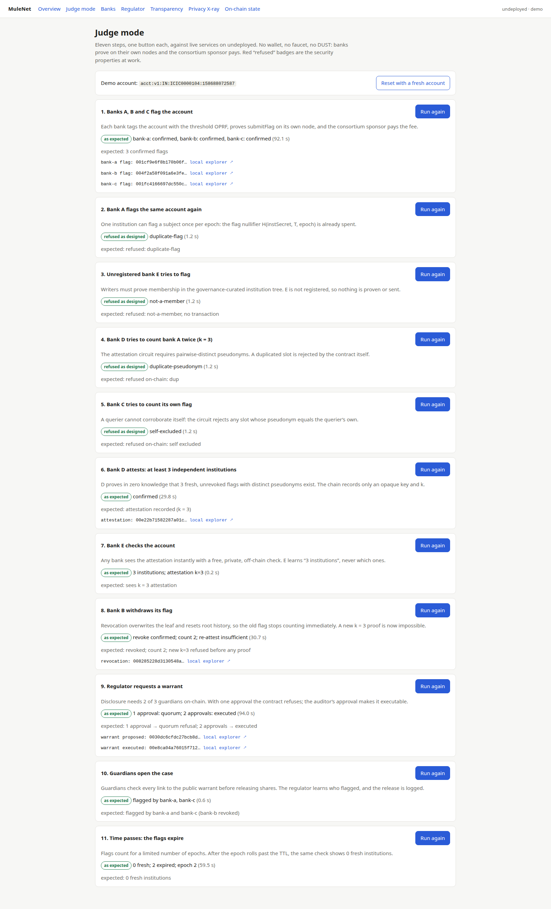
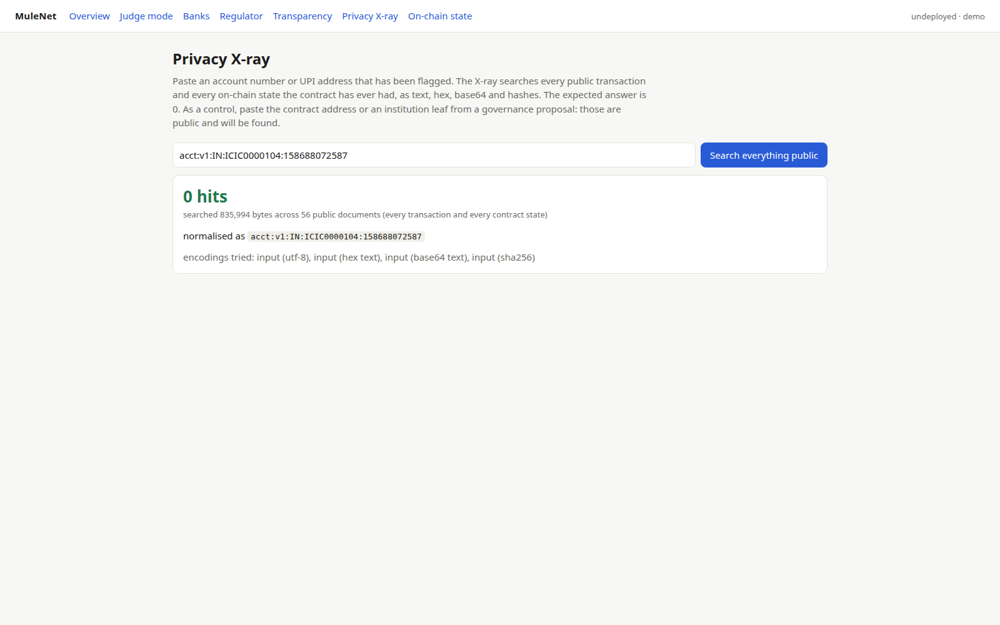
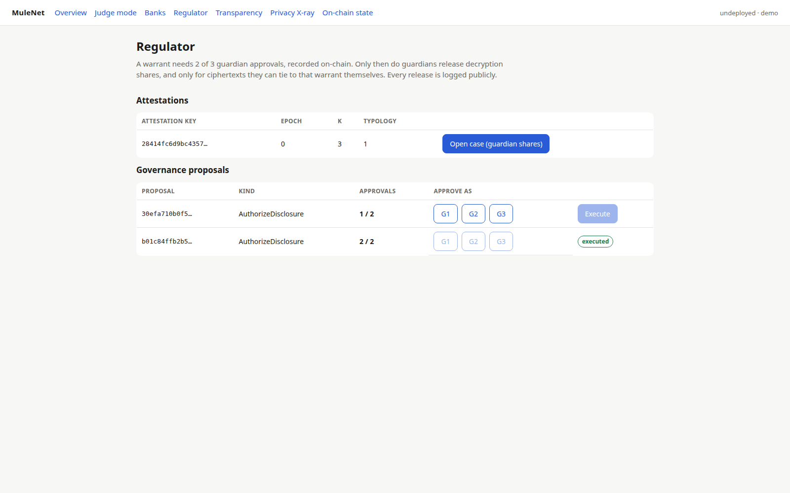
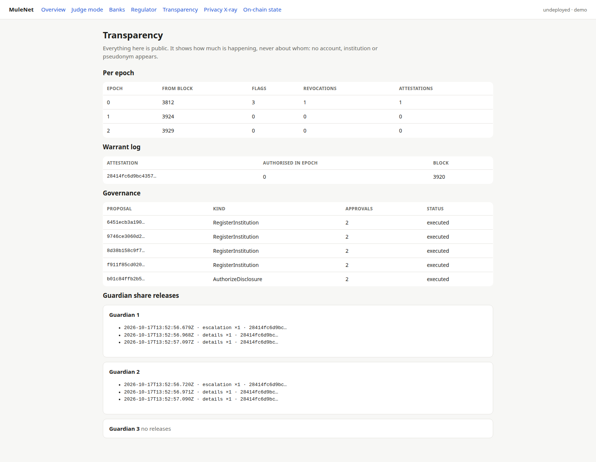
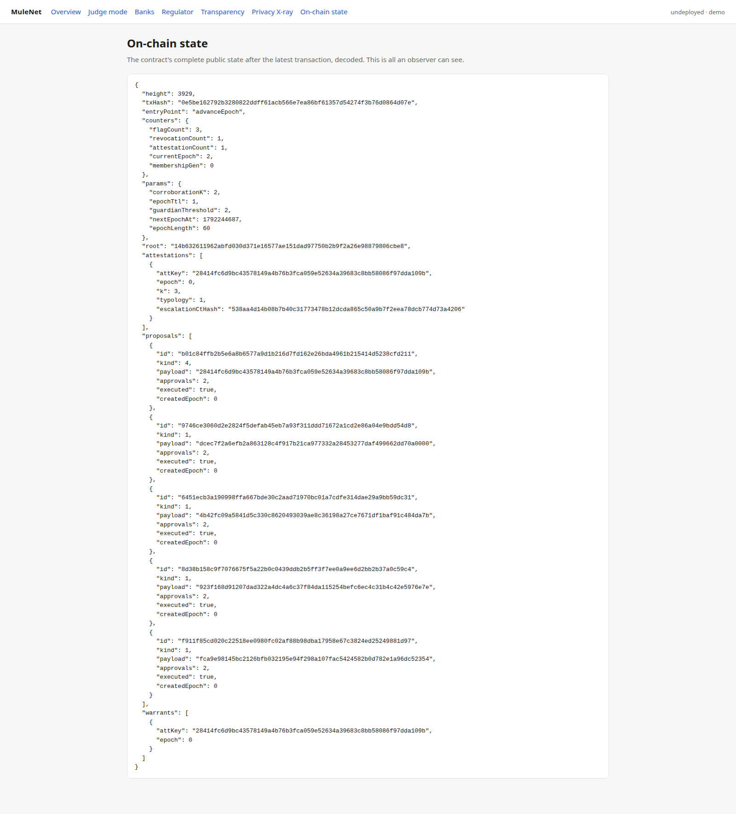

# MuleNet

**Prove an account is flagged by enough banks — without any bank learning who else flagged it.**

MuleNet lets banks and payment institutions ask one question: *"Have at least k independent institutions flagged this account as a mule?"* No bank learns which institutions flagged it. No outsider learns which account was asked about. No institution can inflate the count. Identities are recoverable only under a 2-of-3 guardian warrant that is logged publicly on-chain.

Built on [Midnight](https://midnight.network) (ledger 8, Compact 0.31.1). Apache-2.0.

> The privacy isn't a feature — it's the only legal way this data can be shared. Pooling raw mule lists collides with bank secrecy, STR/SAR confidentiality and data-protection law; MuleNet shares *proofs*, not lists.

---

## Try it

| | |
|---|---|
| **Judge mode** | 11 buttons that run the whole demo against live services (`apps/console`, route `/judge`) |
| **Locally** | see [Run it locally](#run-it-locally) — one devnet, `npm run dev:up`, open `http://localhost:3000/judge` |
| **Verify, don't trust** | `npx tsx verify/src/cli.ts deployment --address <addr>` checks the deployed circuits against the release, from public chain data only |

### Screenshots

From a fresh demo deployment on the local network (17 Oct 2026), captured by `scripts/screenshots.sh`.

| | |
|---|---|
| [](docs/media/judge-mode.png) | **Judge mode, completed.** Every step shows "as expected" or "refused as designed". |
| [](docs/media/xray-zero-hits.png) | **Privacy X-ray.** The account judge mode just flagged, searched across every public transaction and contract state: 0 hits. |
| [](docs/media/regulator.png) | **Regulator.** A warrant with 1 of 2 approvals cannot be executed; the earlier one with 2 of 2 was. |
| [](docs/media/transparency.png) | **Transparency.** Per-epoch counts, the warrant log, governance and every guardian share release. |
| [](docs/media/on-chain-state.png) | **On-chain state.** The contract's whole public state, decoded: everything an observer can see. |

## How it works

1. **Subject tags, not account numbers.** An account (`acct:v1:IN:HDFC0001234:…`, a UPI VPA, a UK account) is turned into a tag `T` by a **2-of-3 threshold OPRF** (RFC 9497 VOPRF, ristretto255). Oracles never see the account; nobody can compute `T` offline, so the account space can't be brute-forced.
2. **One shared flag tree.** Every flag is a *hidden* leaf in a single Merkle tree: `H(T, pseudonym, epoch, typology, ctHash)`. The pseudonym `H(instSecret, T)` is stable per (bank, account) and unlinkable across accounts. A per-institution tree would leak *which* institutions were used, because `checkRoot` discloses roots — so there is exactly one tree.
3. **Anonymous but registered.** Every write proves membership in a governance-curated institution set (no signatures in-circuit: ledger 8 has none).
4. **Attestations.** A bank proves in zero knowledge that ≥ k fresh, unrevoked flags with **pairwise-distinct pseudonyms**, none its own, exist for `T`. The chain records only an opaque key and k.
5. **Warrant-logged disclosure.** Who flagged is encrypted to a 2-of-3 guardian key. Guardians release decryption shares only after a 2-of-3 warrant is executed on-chain, and only for ciphertexts they can cryptographically tie to it. Every release is logged.

Checks are **free and private**: no transaction, off-chain, verified against on-chain state. Banks hold **no tokens**: they prove on their own nodes and a consortium sponsor pays DUST fees.

## What an observer learns (per circuit)

| Circuit | Private inputs | Public | An observer learns |
|---|---|---|---|
| `submitFlag` | institution secret, `T`, typology, case-ciphertext hash, quota slot, membership path | flag & quota nullifiers, leaf hash, institutions root, counter | "some member flagged something" |
| `revokeFlag` | institution secret, `T`, flag fields, paths | revoked index, roots | "flag #i was withdrawn" |
| `attestCorroboration2/3` | institution secret, `T`, k slots | attestation key, k, typology, escalation hash, querier tag, one root | "some member attested ≥ k for some subject in epoch E" |
| `propose` / `approve` / `execute` | guardian secret, path | kind, payload, vote nullifier | governance actions (public by design) |
| `advanceEpoch` | — | epoch, schedule | public by design |

Full leakage register and threat model: [docs/ARCHITECTURE.md](docs/ARCHITECTURE.md) §10–11.

## Evidence

| | |
|---|---|
| Contract tests | 140 in the simulator: unit, invariants I1–I7, an adversarial file per threat-model row, `attest2`/`attest3` parity, static rules ([docs/TESTING.md](docs/TESTING.md)) |
| Reference-model property test | random flag/revoke/epoch/attest sequences; the contract must accept **exactly** what a plain TypeScript model accepts. Mutation-checked: three planted model bugs are each caught |
| Crypto | 76 tests incl. **RFC 9497 test vectors**, 2-of-3 ≡ single-key equivalence for every oracle pair, threshold ElGamal with DLEQ-proven shares |
| Services | oracle, relay, sponsor, bank node, guardian, explorer: 70+ tests; bank-node flows run against the real contract in the simulator |
| End to end | the full demo script passes on a live local network with every service as its own process (`tests/integration`) |
| Leak scan | 39 secrets × all encodings, across every service log and database: **0 findings** |
| Privacy X-ray | account identifiers: **0 hits** across every public transaction and state; public values (contract address, institution leaves) are found, so the zero is real |
| Proving time (laptop, depth-20 tree) | `attestCorroboration3` **8.1 s**, `submitFlag` **5.5 s** warm, `revokeFlag` 4.4 s ([docs/BENCHMARKS.md](docs/BENCHMARKS.md)) |
| Sponsorship | bank wallets hold **0 DUST** before and after; a tampered sponsored transaction is rejected by the network; no bank wallet key appears in the transaction bytes (two local S6.1 scans, ADR 0016; Preprod confirmation pending) |
| Reproducibility | verifier keys are deterministic; CI rebuilds them and compares with [docs/verifier-keys.json](docs/verifier-keys.json) |

## Honest limits

- **Truthfulness of flags is not provable.** Cryptography proves who may flag and how many distinct institutions did; accountability (warrants) and revocation handle false flags.
- **No proof of absence.** MuleNet attests "≥ k" only; "fewer than k" is not attested.
- **The anonymity set is the set of active institutions.** With three demo banks it is tiny; the design matters at 30+.
- **Infrastructure metadata.** The sponsor and relay see which institution connects (mitigated by batching/shuffling; see L1, L7, L8). Two colluding guardians could decrypt without a warrant (L10) — releases are logged and guardians should be independent.
- **`T` is not proven OPRF-derived in-circuit** (no ristretto ops in Compact). A wrong `T` only means a bank flags a subject nobody else can match; quotas cap abuse.
- **Trusted dealer** for the OPRF and guardian keys in this build (ADR 0014); production uses a DKG.
- **Maintenance authority** is single-signature during the Wave; changes are publicly detectable by `mulenet-verify` (ADR 0015).

## Repository

```
contracts/          Compact contract (8 circuits) + simulator test suites
packages/crypto     normalisation, threshold OPRF, threshold ElGamal, relay records, hash mirrors
packages/sdk        Midnight.js providers, wallet + sponsorship, config, signed service clients
packages/service-kit Fastify factory, Ed25519 request signatures, node:sqlite
services/           oracle ×3 · relay · sponsor (+ epoch keeper) · bank-node · guardian · explorer
apps/console        Next.js: analyst, regulator, transparency, privacy x-ray, on-chain state, judge mode
verify/             mulenet-verify CLI
tools/leak-scan     leak scanner (SARIF, self-test)
tests/integration   live-network integration tests (phase 4 flag→check, phase 5 demo script)
docs/               architecture, plans, ADRs, benchmarks, testing
```

## Run it locally

Requires Node 22+, Docker, and the Compact toolchain **0.31.1** (`compact update 0.31.1`).

```bash
npm ci
npm run compact                                   # compile the contract (≈2 min)
npm run build -w contracts -w packages/crypto -w packages/service-kit -w packages/sdk

MN_PROOF_SERVER_PORT=6301 docker compose -f infra/local/standalone.yml -p mulenet-local up -d
export MN_PROOF_SERVER=http://127.0.0.1:6301

npm run keygen -- undeployed                      # consortium keys (trusted dealer)
(cd packages/sdk && npx tsx scripts/bootstrap.ts undeployed --skip bank-e)
MULENET_DEMO_HOOKS=1 npm run dev:up              # oracles, relay, sponsor, banks, guardians, explorer
(cd apps/console && npm run build && npm start)   # http://localhost:3000
```

**After a host reboot, reset the local network.** The local node (1.0.0) does not resume cleanly from its persisted chain data: block production stalls, and transactions fail with `host code panicked … root should be in the arena`. Reset it with `docker compose -f infra/local/standalone.yml -p mulenet-local down -v`, bring it back up, and re-run the bootstrap. This affects only the local devnet.

Tests: `npm test -w contracts`, `npm test -w packages/crypto`, `npm run test:integration`, `npm run leak-scan`.

## Technical gate

- [x] Compact contract compiles on toolchain 0.31.1 (CI)
- [x] Meaningful Midnight use: 8 circuits, hidden-leaf Merkle trees, nullifiers, fee sponsorship
- [x] `midnightntwrk` topic on the repository
- [x] Apache-2.0
- [ ] Default branch is the submitted state, tagged `wave3-submission`

## License

Apache-2.0. See [LICENSE](LICENSE).
