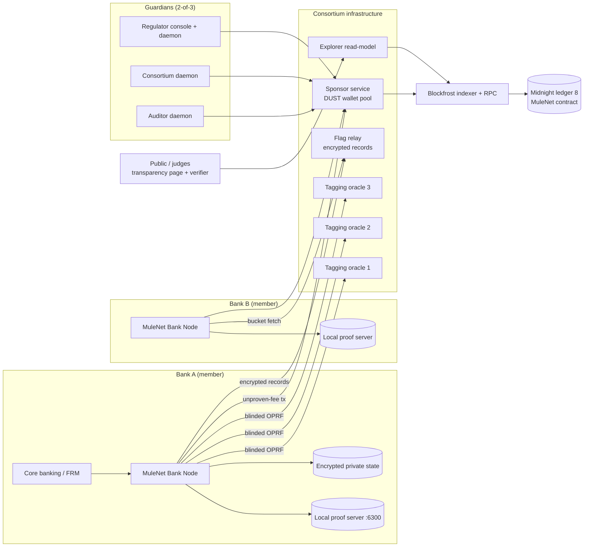
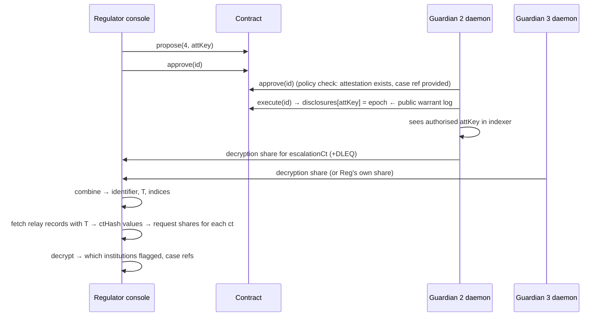

# MuleNet — System Architecture

**Private cross-institution mule-account corroboration on Midnight**

| | |
|---|---|
| Document | Architecture specification, v1.1 (see the changelog at the end) |
| Date | 14 October 2026 |
| Target | Midnight Buildathon (AKINDO), Wave 3 |
| Target network | Midnight **ledger 8** — local `undeployed` → `preprod` (judge-visible) → `mainnet` (stretch) |
| Toolchain pin | Compact toolchain **0.31.1**, compact-runtime **0.16.0**, Midnight.js **4.1.1**, wallet SDK **1.2.0**, proof server **8.1.3** |
| License | Apache-2.0, repo topic `midnightntwrk` |

---

## 0. TL;DR

MuleNet lets banks and payment institutions answer one question: **"Have at least *k* independent institutions flagged this account as a mule?"** No bank learns which institutions flagged it. No outsider learns which account was asked about. No institution can inflate the count.

It does this with five mechanisms:

1. **OPRF subject tags.** Account identifiers are turned into pseudorandom tags `T` by a 2-of-3 threshold OPRF. The oracle never sees account numbers, and no one can brute-force the account space offline.
2. **One shared flag tree with per-subject pseudonyms.** Every flag is a hidden leaf in a single `HistoricMerkleTree`. Each leaf carries the flagger's pseudonym `p = H(instSecret, T)`. The pseudonym is stable for one (institution, subject) pair and unlinkable across subjects.
3. **Anonymous-but-registered institutions.** Every write proves Merkle membership in a governance-curated institution set. There are no signatures in-circuit, so it is deployable on ledger 8 today.
4. **On-chain corroboration attestations.** A querying bank proves in zero knowledge that ≥k fresh, unrevoked flags with pairwise-distinct pseudonyms exist for `T`. The result is recorded under a key only `T`-holders can compute.
5. **Warrant-logged de-anonymisation.** Who flagged is encrypted to a 2-of-3 guardian key. Decryption shares are released only after a t-of-n approval is recorded on-chain, so every disclosure leaves a public warrant trail.

The privacy property is the product. The design works only because raw sharing is legally impossible.

---

## 1. Verified platform baseline (as of 14 Oct 2026)

Everything below was checked against the official Midnight docs this week. Design decisions depend on these facts, so re-check the support matrix before you start coding.

| Fact | Consequence for MuleNet |
|---|---|
| Preview, Preprod and Mainnet all run **ledger 8**. The support matrix pins **Compact toolchain 0.31.1**, runtime 0.16.0 and Midnight.js 4.1.1. Toolchains 0.34/0.35 target ledger 9, and their contracts **cannot be deployed** to these networks. | Pin `compact update 0.31.1`. Do not install bare `compact update`, because it pulls 0.35. |
| Native `jubjubSchnorrVerify`, `secp256k1EcdsaVerify`, `ed25519Verify`, events and cross-contract calls exist in the current stdlib docs, but only in ledger-9 toolchains (≥0.33/0.34). | **No in-circuit signatures.** Authorisation uses the derived-identity and Merkle-membership patterns. An official Schnorr polyfill (`example-zkloan/contract/src/schnorr.compact`) exists for 0.31.1 if you ever need one. |
| `persistentHash` / `persistentCommit` are SHA-256 based and stable across upgrades. `transient*` are circuit-optimised but not stable. | Everything stored on-ledger uses `persistent*`. `transient*` is never stored. |
| A `MerkleTree` / `HistoricMerkleTree` insert is **the one ledger operation that hides its argument**. Every other ledger argument (Set/Map keys and values, Counter amounts, disclosed values) is public. | Flags live as hidden tree leaves. Set and Map keys are always pseudorandom hashes. |
| `checkRoot(disclose(root))` puts the **root** on the public transcript. | Any design that proves against *per-institution* trees leaks which institutions were used. MuleNet uses **one shared tree** (see §1.1). |
| `HistoricMerkleTree` accepts proofs against past roots and supports `resetHistory()` and `insertIndexDefault(index)`, which emulates removal. | Concurrency-safe proofs, revocation by overwriting a leaf, and bounded history (reset on every epoch roll). |
| Node 1.0.400 (ledger 8.1.3) rejects non-canonical transcript values. There is an advisory for Sets and Maps **keyed by values containing `Field`**. | All Set and Map keys are `Bytes<32>`. MuleNet never keys on `Field`. |
| Midnight-hosted mainnet endpoints were retired 30 Sep 2026. Preprod endpoints shut down from 22:00 UTC on 9 Oct 2026. **Preprod and Mainnet indexer/RPC are now served by Blockfrost** and need a per-network project token. Only Preview is still Midnight-hosted. | All chain access goes through server-side services that hold the Blockfrost token. The token is never shipped to the browser. |
| The proof server always runs **locally** on port 6300, because it sees witness data in the clear. | Every bank node runs **its own** proof server. There is no shared prover. |
| DUST is non-transferable. Fee sponsorship is wallet-side: the user balances without DUST, and the sponsor balances with `tokenKindsToBalance: ['dust']` and submits. The network rejects modified transactions. | A consortium sponsor pays all fees. The fee payer is therefore never the bank, which hides who submitted. |
| Block limits: 200 KB broadcast, **50 KB persistent writes**, 1 s compute and 1 s read per block. Max tx 1 MiB. **Per-account throttle of 10 MB of tx data per day.** | Small state writes. A **pool of sponsor wallets** to stay under the per-account throttle. |
| Midnight's wallet reference lists Dynamic's Midnight support as **unconfirmed**. | Banks integrate server-to-server through headless wallets. Lace is optional for the guardian console only. |
| Permissionless mainnet deployment went live on 2 Oct 2026 (widely reported). The docs' mainnet checklist (updated 12 Oct) **still** describes a deployment-authorisation PR to the MIP repo. | Treat mainnet as a stretch goal. Confirm the current rule in Discord before relying on it. |
| Midnight's Request for Startups lists **"ZK-Corporate AML"** and **"Automated Regulatory Reporting Engine"** under Smart Compliance. | Use this as Product-and-Vision ammunition in the pitch. |

### 1.1 Corrections to the earlier dossier's MuleNet design

| Dossier proposed | Problem | This architecture |
|---|---|---|
| One Merkle tree per institution; prove membership in k distinct roots | Roots are disclosed by `checkRoot`, so the transcript reveals *which* institutions' trees were used. That defeats the core privacy claim. | One shared flag tree. Distinctness is enforced on **pseudonyms inside hidden leaves**. |
| `secp256k1EcdsaVerify` for regulator-signed registration | Not available on ledger 8 / toolchain 0.31.1 | Governance-approved Merkle membership (no signatures) |
| In-circuit Schnorr verification of t-of-n Shamir shares | Not available natively. It is also unnecessary and was the dossier's top feasibility risk. | On-chain t-of-n **approval counting** plus off-chain **threshold ElGamal** decryption |
| "Querier learns only a boolean" | Impossible with the querier as prover, because the prover knows its own witness | The querier learns **count, pseudonyms, epochs and typologies**, never institution identities. This is stated honestly. |
| Subject commitment = `persistentHash(accountId)` | Account numbers are low-entropy and brute-forceable offline | Threshold-OPRF tags, rate-limited and audited |
| Dynamic embedded wallets for walletless demo | Midnight support unconfirmed in official docs | Server-side bank nodes plus sponsored DUST. This matches how banks actually integrate. |
| Proof server 8.1.0 | The matrix now says 8.1.3 | 8.1.3 |

---

## 2. Problem and pitch

**One line:** *Prove an account is flagged by enough banks without any bank learning who else flagged it.*

**Why now.** Mule accounts are the receiving infrastructure of authorised-push-payment (APP) and cyber fraud. The receiving bank sees the money arrive but not the pattern across institutions. Pooling raw flag lists would solve detection, but it collides with bank secrecy, SAR/STR confidentiality and data-protection consent rules (for example the DPDP Act 2023 in India). It would also create a breach-magnet database. The demand evidence (UK Finance 2025 figures, I4C Suspect Registry numbers, the RBI mule SOP, FinCEN 314(b)) is in the research dossier. Re-verify each figure before it goes in the deck.

**Users.**

| Persona | Role in MuleNet |
|---|---|
| Fraud-ops analyst at a member bank | Flags accounts, checks inbound beneficiaries, attests and escalates |
| Bank compliance head (economic buyer) | Wants an auditable record that checks were done correctly |
| Regulator / FIU (guardian) | Approves disclosure warrants and receives de-anonymised case data |
| Consortium operator (guardian) | Onboards institutions, runs the tagging oracle, sponsor and relay |
| Independent auditor (guardian) | Third key in the 2-of-3 warrant and decryption quorum |
| Public / judges | Read the transparency page and run the independent verifier |

---

## 3. Security goals and non-goals

### 3.1 Properties MuleNet must guarantee

| ID | Property | Enforced by |
|---|---|---|
| **P1** Subject privacy | No chain observer, and no non-member, can learn which account was flagged, checked or attested. | OPRF tags; tags appear only inside hidden leaves or under hashed keys |
| **P2** Flagger anonymity | No one, the querier included, learns which institution flagged a subject. Exception: an authorised warrant. | Shared tree; pseudonyms `H(instSecret, T)`; sponsored fees |
| **P3** Sybil-resistant counting | One institution contributes at most 1 to a subject's count. | Deterministic pseudonym plus in-circuit pairwise distinctness |
| **P4** Registered writers only | Only governance-approved institutions can flag, revoke or attest. | Merkle membership bound to a secret (`path.leaf == H(secret, gen)`) |
| **P5** Soundness of attestations | An attestation `≥k` cannot be produced unless k such flags exist, are fresh and are unrevoked. | Attestation circuit |
| **P6** Revocability | A flagger can withdraw a flag. Withdrawn flags stop counting immediately. | `insertIndexDefault` + `resetHistory` |
| **P7** Accountable de-anonymisation | Identities are recoverable only by a t-of-n guardian quorum, and every authorisation is logged on-chain. | Threshold ElGamal plus on-chain warrant proposals |
| **P8** Offline-enumeration resistance | Even a member cannot list all flagged accounts by hashing the account space. | Threshold OPRF with per-institution rate limits |

### 3.2 Non-goals (say these out loud in the README)

- **Truthfulness of flags.** Cryptography proves *who is allowed* to flag and *how many distinct institutions* did. It cannot prove the flag is correct. That is handled by accountability (P7) and revocation (P6).
- **Proving absence.** "Fewer than k flags" is a non-membership claim, and MuleNet does not attest it. Attestations are monotone, `≥k` only, which is also why a dishonest querier cannot under-report.
- **Hiding network-level metadata from consortium infrastructure.** The sponsor and the relay see which institution connects. See the leakage register in §10.2.
- **Production-grade anonymity with three demo banks.** The anonymity set equals the number of active institutions.

---

## 4. System overview

### 4.1 Context



### 4.2 Components

| Component | Runs where | Holds secrets? | Purpose |
|---|---|---|---|
| **MuleNet contract** (Compact) | Midnight ledger 8 | No | Institution registry, flag tree, nullifiers, attestations, governance and warrants |
| **Bank Node** (TypeScript) | Each bank's premises | `instSecret`, cached tags, record keys | Builds proofs and talks to the oracle, relay and sponsor. REST API for bank systems. |
| **Local proof server** | Next to each Bank Node and guardian daemon | Sees witnesses at proving time | Proves transactions. Never remote. |
| **Tagging oracle ×3** | Consortium, ideally three separate operators | One OPRF key share each | Threshold OPRF evaluation, rate limiting, audit counters |
| **Flag relay** | Consortium (mirrored by banks) | None. It stores ciphertexts only. | Append-only store of encrypted flag records, bucketed by `lookupKey` |
| **Sponsor service** | Consortium | Sponsor wallet seeds | Pre-flight validation, DUST balancing, submission batching and jitter |
| **Guardian daemon ×3** | Each guardian | One decryption key share plus `guardianSecret` | Votes on proposals and releases decryption shares after authorisation |
| **Explorer read-model** | Consortium (anyone can run one) | None | Projects public ledger state into Postgres for dashboards and the verifier |
| **Console** (Next.js) | Browser | No chain keys | Personas: analyst, regulator, public transparency, judge mode |
| **`verify` CLI** | Anyone | None | Independently checks deployments and attestations from public data |

---

## 5. Cryptographic design

### 5.1 Identifier normalisation

Every institution must produce byte-identical input for the same account. Spec `mulenet-id/v1`:

| Kind | Canonical form | Example |
|---|---|---|
| Indian bank account | `acct:v1:IN:{IFSC uppercase}:{account digits, no spaces}` | `acct:v1:IN:HDFC0001234:50100123456789` |
| UPI VPA | `vpa:v1:{lowercase, trimmed}` | `vpa:v1:rahul.k@okaxis` |
| UK account | `acct:v1:GB:{sort code 6 digits}:{account 8 digits}` | `acct:v1:GB:401276:12345678` |

Reject anything that fails a strict regex. Bugs here become silent false negatives, so ship test vectors.

### 5.2 Subject tag `T` (threshold OPRF)

The OPRF is 2HashDH over ristretto255. Use RFC 9497 primitives (`ristretto255-SHA512` hash-to-group and DLEQ proofs) with a **2-of-3 Shamir-shared key `k`** (the TOPPSS-style threshold construction).

```
Client (Bank Node)                         Oracle i (holds k_i, publishes K_i = k_i·G)
x  = normalise(identifier)
r  ← random scalar
B  = r · H2G(x)                 ── B ──▶
                                ◀─ Z_i = k_i·B, DLEQ(K_i, Z_i) ──   (rate-limited per institution)
verify DLEQ for 2 responses
Z  = λ_a·Z_a + λ_b·Z_b          // Lagrange in the exponent → k·B
N  = r⁻¹ · Z                    // = k·H2G(x)
y  = RFC9497.Finalize(x, N)          // = SHA-512(len‖x‖len‖N‖"Finalize")
T  = SHA-256("mulenet:tag:v1" ‖ y)   // domain-separated 32-byte tag
```

- Oracles learn neither `x` nor `T`. They learn **query volume per institution**, and they enforce daily quotas and alert on enumeration-like bursts.
- Without ≥2 oracles cooperating, no one, banks included, can compute `T` for arbitrary accounts. That is property P8.
- The circuit **cannot** verify that `T` was OPRF-derived, because ristretto ops are not in Compact. That is acceptable: a wrong `T` only means a bank flags or queries a subject nobody else can match.
- Library: `@noble/curves` (ristretto255, hash-to-curve). Implement DLEQ per RFC 9497 §2.2 and test against its vectors.

### 5.3 Derived values and domain separation

All hashes are `persistentHash<Vector<n, Bytes<32>>>([pad(32, DOMAIN), ...])`. Integers are encoded as `(x as Field) as Bytes<32>`, the pattern from the official docs.

| Value | Definition | Visibility |
|---|---|---|
| Institution leaf | `H("mulenet:inst:v1", instSecret, gen)` | Hidden leaf (the payload is public in the registration proposal, but it is a hash of a secret) |
| Guardian leaf | `H("mulenet:guardian:v1", guardianSecret)` | Constructor argument |
| Pseudonym `p` | `H("mulenet:pseud:v1", instSecret, T)` | Inside hidden leaves and encrypted records only |
| Flag leaf | `H("mulenet:flag:v1", T, p, epoch, typology, ctHash)` | Hidden leaf (the leaf hash is visible in tree state, the preimage is not) |
| Flag nullifier | `H("mulenet:flagnf:v1", instSecret, T, epoch)` | Public Set key |
| Flag quota nullifier | `H("mulenet:quota:v1", instSecret, epoch, slot)`, `slot < flagQuota` | Public Set key |
| Revocation quota nullifier | `H("mulenet:rvquota:v1", instSecret, epoch, slot)`, `slot < revokeQuota` | Public Set key |
| Attestation key | `H("mulenet:att:v1", T, epoch, typology)` | Public Map key, computable only by `T`-holders |
| Querier tag | `H("mulenet:qtag:v1", instSecret, attKey)` | Public; lets the querier later prove authorship |
| Proposal id | `H("mulenet:prop:v1", kind, payload, nonce)` | Public |
| Vote nullifier | `H("mulenet:vote:v1", guardianSecret, proposalId)` | Public Set key |
| Value commitment | `H("mulenet:value:v1", value)` | Public (governance parameter changes) |

Rules (from the Midnight security checklist): every derivation has a unique domain. No nullifier shares a domain with a commitment. All strings are ≤32 bytes. Never key a Set or Map on a value containing `Field`.

**Why each value is shaped this way**

- `p` excludes the epoch, so the same institution has the **same pseudonym across epochs** for a subject. It can never count twice.
- `p` includes `T`, so pseudonyms are **unlinkable across subjects**. A querier who checks many accounts cannot build a profile of "pseudonym X = Bank A".
- The flag nullifier includes the epoch, so a bank can re-flag after expiry but not spam within an epoch. It uses its own domain, so it cannot be linked to `p`.
- The flag leaf does **not** include its index. `submitFlag` uses `flags.insert`, which takes the next free position on-chain, so flags proven against the same state do not conflict and the sponsor can batch them. Revocation derives the index from the path's `goes_left` bits in-circuit (`pathIndex`) and asserts it equals the public `index`.
- Quota nullifiers give every institution an anonymous per-epoch budget of flags and revocations. The circuit cannot check that `T` came from the OPRF, so without them a member could fill the tree with random tags, or loop flag→revoke to keep resetting root history.

### 5.4 Encrypted flag record (off-chain, in the relay)

```
lookupKey = HKDF-SHA256(T, info="mulenet:lookup:v1", 32)
bucket    = lookupKey[0..2]                       // 65,536 buckets → k-anonymous fetch
recKey    = HKDF-SHA256(T, info="mulenet:rec:v1", 32)
record    = {
  v: 1, bucket, lookupKey,
  nonce: 24 bytes,
  body: XChaCha20-Poly1305(recKey, nonce,
          CBOR{ p, epoch, typology, ctHash, index, flaggedAt })
}
```

Any member that can obtain `T` for an account can read its records. Those records reveal pseudonyms and epochs, never institutions. The relay sees opaque buckets.

### 5.5 Case-detail ciphertext (for warrants only)

```
details   = CBOR{ institutionId, caseRef, typology, evidenceSummary, contactRef }
ct        = ThresholdElGamal-KEM(guardianGroupKey) ‖ AEAD(details)
ctHash    = SHA-256(ct)        // committed inside the flag leaf
```

The guardian group key is a 2-of-3 Shamir-shared ristretto255 key, generated by a Pedersen DKG or a trusted dealer at setup. Document which one you use. Decryption shares carry DLEQ proofs. Because `ctHash` sits in the leaf, a flagger cannot swap details after the fact.

Attestations carry an `escalationCtHash` of the same shape. Its plaintext is `{ canonical identifier, T, leaf indices, querier institutionId, caseRef }`.

### 5.6 Data classification

| Data | Bank node | Oracle | Relay | Sponsor | Chain | Guardians (after warrant) |
|---|---|---|---|---|---|---|
| Raw account identifier | own customers only, transient | ✗ | ✗ | ✗ | ✗ | ✓ |
| `T` | ✓ (no long-term cache) | ✗ | ✗ | ✗ | ✗ (only inside hashes and hidden leaves) | ✓ |
| `instSecret` | ✓ (encrypted at rest) | ✗ | ✗ | ✗ | ✗ | ✗ |
| Pseudonyms | ✓ for subjects it queries | ✗ | ciphertext | ✗ | hidden leaves | ✓ |
| Which institution flagged | own flags only | ✗ | ✗ | timing only | ✗ | ✓ |
| Counts per epoch | ✓ | ✗ | approx. | ✗ | ✓ (public counters) | ✓ |

---

## 6. On-chain contract

### 6.1 Ledger state

| Field | Type | Purpose | Growth bound |
|---|---|---|---|
| `guardians` | `HistoricMerkleTree<4, Bytes<32>>` | Guardian leaves (max 16) | Fixed |
| `guardianThreshold` | `Uint<8>` (sealed) | t in t-of-n | — |
| `membershipGen` | `Uint<32>` | Bumped to evict institutions | — |
| `institutions` | `HistoricMerkleTree<6, Bytes<32>>` | Institution leaves (64 slots across gens) | 64 |
| `flags` | `HistoricMerkleTree<20, Bytes<32>>` | Hidden flag leaves (~1M per deployment) | 2²⁰, then rotate season |
| `flagCount` | `Counter` | Public total (write-only in circuits) | — |
| `quotaNullifiers` | `Set<Bytes<32>>` | Per-epoch flag and revocation quota slots | Linear in flags |
| `flagQuota` / `revokeQuota` | `Uint<16>` (sealed) | Per-institution per-epoch caps (e.g. 500 / 3) | — |
| `flagNullifiers` | `Set<Bytes<32>>` | One flag per (inst, subject, epoch) | Linear in flags |
| `revocationCount` | `Counter` | Public revocation total | — |
| `currentEpoch` | `Uint<32>` | Epoch number | — |
| `nextEpochAt` | `Uint<64>` | Unix seconds of next roll | — |
| `epochLength` | `Uint<64>` (sealed) | e.g. 86,400 s | — |
| `epochTtl` | `Uint<32>` | Flags count for this many epochs (e.g. 30) | — |
| `attestations` | `Map<Bytes<32>, Attestation>` | Keyed by `attKey` | One per (subject, epoch, typology) |
| `attestationCount` | `Counter` | Public total | — |
| `proposals` | `Map<Bytes<32>, Proposal>` | Governance and warrants | Linear in proposals |
| `proposalNonce` | `Counter` | Uniqueness | — |
| `voteNullifiers` | `Set<Bytes<32>>` | One vote per guardian per proposal | Linear |
| `disclosures` | `Map<Bytes<32>, Uint<32>>` | `attKey → authorising epoch` (the public warrant log) | Linear in warrants |

### 6.2 Circuits

| # | Circuit | Caller | Proves / does | Public side effects |
|---|---|---|---|---|
| 0 | `constructor` | Deployer | Seeds guardians and parameters | Guardian leaves, thresholds, epoch schedule |
| 1 | `propose(kind, payload, gPath)` | Guardian | Anonymous guardian membership | New proposal `{kind, payload}` |
| 2 | `approve(id, gPath)` | Guardian | Membership plus a fresh vote nullifier | Vote nullifier, approvals + 1 |
| 3 | `execute(id, value)` | Anyone | approvals ≥ t, not executed, not expired | Applies the action (see 6.4) |
| 4 | `advanceEpoch()` | Anyone (keeper) | `blockTimeGte(nextEpochAt)` | Epoch + 1, schedule update, `flags.resetHistory()` |
| 5 | `submitFlag(T, typology, ctHash, quotaSlot, instPath)` | Institution | Membership; quota slot and nullifier fresh | Quota nullifier, flag nullifier, hidden leaf at the next free index, counter |
| 6 | `revokeFlag(T, epoch, typology, ctHash, index, quotaSlot, leafPath, instPath)` | Original flagger | Membership; revocation quota; leaf recomputes with own pseudonym; `pathIndex(leafPath) == index`; leaf in tree | `insertIndexDefault(index)`, `resetHistory()`, counter |
| 7 | `attestCorroboration3(T, typology, slots[3], instPath, escCtHash)` | Institution | Membership; 3 valid, fresh, distinct, non-self slots | `attestations[attKey]`, counter |
| 8 | `attestCorroboration2(...)` | Institution | Same with 2 slots | Same |

Two fixed-shape attestation circuits replace a variable-k circuit. Compact needs compile-time-bounded shapes, and two small circuits are easier to benchmark than one masked circuit. The governance-set `corroborationThreshold` decides which one the policy accepts.

### 6.3 Contract (Compact)

The contract lives in [`contracts/src/mulenet.compact`](../contracts/src/mulenet.compact). It compiles on toolchain 0.31.1 with every v1.0 `VERIFY` item resolved, and it is the source of truth: this section only summarises how it differs from the v1.0 sketch.

- **Flag index from the path.** The leaf is `flagLeaf(T, p, epoch, typology, ctHash)` with no index. `submitFlag` calls `flags.insert(...)`, and `revokeFlag` checks `pathIndex(leafPath) == index`. The compiled `insert` has no proven read of the next free index, so concurrent flags do not conflict.
- **Quotas.** `submitFlag` and `revokeFlag` each consume a quota nullifier (§5.3), bounded by the sealed `flagQuota` and `revokeQuota`.
- **One root per attestation.** Every slot must hash up to the same root (`"mixed roots"`), so only that one root is disclosed. This enforces the L4 mitigation and saves two `checkRoot` calls.
- **Governance checks.** The constructor and `execute` range-check k (2–3) and TTL (1–90). `approve` enforces the 7-epoch expiry, as `execute` does. `AuthorizeDisclosure` requires the attestation to exist.
- **Exported pure circuits.** Every §5.3 derivation (`institutionLeaf`, `pseudonym`, `flagLeaf`, `attestationKey`, `proposalId`, …) is exported, so off-chain code computes byte-identical values through `pureCircuits`.

### 6.4 Invariants (each becomes a named test)

| ID | Invariant |
|---|---|
| I1 | Every leaf in `flags` was inserted by a circuit that proved institution membership at the current `membershipGen`. |
| I2 | For a fixed (instSecret, T, epoch), at most one leaf exists. |
| I3 | An attestation with `k = n` implies n leaves with pairwise-distinct pseudonyms, all with `epoch ≥ currentEpoch − ttl`, none equal to the querier's pseudonym, all present under a root valid at proof time. |
| I4 | After `revokeFlag(index)`, no attestation can include the leaf at `index`. |
| I5 | `flagCount` equals the number of `submitFlag` executions. A revocation clears exactly the leaf whose path encodes `index`. |
| I6 | A proposal executes at most once, only with ≥ t distinct guardian votes, and only within 7 epochs of creation. |
| I7 | After a membership rotation, previous-gen institution leaves can no longer satisfy `assertInstitution`. |
| I8 | No public transcript or ledger value equals a raw identifier, `T`, `instSecret`, `guardianSecret` or a pseudonym. This is checked by the leak scanner (§14.4). |

### 6.5 Witness and private-state implementation (TypeScript)

```ts
export type MuleNetPrivateState = {
  institutionSecret?: Uint8Array; // 32 bytes, crypto.getRandomValues — never Math.random
  guardianSecret?: Uint8Array;
};

const need = (v: Uint8Array | undefined, name: string) => {
  if (!v) throw new Error(`${name} not provisioned`); // message must not leak private data
  return v;
};

export const witnesses = {
  institutionSecret: ({ privateState }: { privateState: MuleNetPrivateState }) =>
    [privateState, need(privateState.institutionSecret, 'institution secret')] as const,
  guardianSecret: ({ privateState }: { privateState: MuleNetPrivateState }) =>
    [privateState, need(privateState.guardianSecret, 'guardian secret')] as const,
};
```

Private state lives in `levelPrivateStateProvider`, which uses AES-256-GCM with password rules enforced by the v4 provider (≥16 chars and so on). The node also keeps an **encrypted secret backup** under the bank's HSM or KMS. The docs are explicit that a lost witness secret has no on-chain recovery. MuleNet's recovery path is governance: register a new leaf, then rotate membership.

---

## 7. Protocol flows

### 7.1 Institution onboarding

```mermaid
sequenceDiagram
  participant Bank as Bank Node
  participant G as Guardians (2 of 3)
  participant C as MuleNet contract
  Bank->>Bank: instSecret ← CSPRNG; leaf = institutionLeaf(instSecret, gen)
  Bank->>G: KYB package + leaf (out of band)
  G->>C: propose(1, leaf)
  G->>C: approve(id) ×2
  G->>C: execute(id)  → institutions.insert(leaf)
  Bank->>Bank: fetch institutions tree, pathForLeaf → instPath cached
```

### 7.2 Flag an account

```mermaid
sequenceDiagram
  participant FRM as Bank A fraud system
  participant N as Bank A node
  participant O as Oracles (2 of 3)
  participant R as Relay
  participant S as Sponsor
  participant C as Contract
  FRM->>N: POST /flags {identifier, typology, caseRef}
  N->>N: x = normalise(identifier)
  N->>O: blinded OPRF (B)  → Z_i + DLEQ
  N->>N: T, p = H(instSecret,T); ct = Enc_guardians(details); ctHash
  N->>N: pick a free quota slot; build submitFlag tx; prove locally
  N->>S: unbalanced-fee tx
  S->>S: preflight (contract addr, circuit allowlist, quota) → epoch-batch + jitter
  S->>C: balance DUST, submit
  C-->>N: tx finalised; node locates its leaf once and stores idx
  N->>R: PUT record(bucket, lookupKey, Enc_recKey{p, epoch, typology, ctHash, idx})
  N->>N: forget x and T (store only case mapping in bank's own system)
```

Concurrent flags do not conflict, because `insert` places the leaf at whatever position is free when the transaction executes. A transaction can still fail if the epoch rolls or membership rotates between proving and inclusion. The node then re-reads state and re-proves, at most twice.

### 7.3 Check a beneficiary (off-chain, free, private)

1. Bank B receives an inbound credit for account `x`. Its FRM calls `POST /check`.
2. The node computes `T` via the OPRF, derives `lookupKey`, `bucket` and `recKey`, and downloads the **whole bucket** from the relay.
3. It decrypts the records matching `lookupKey`, recomputes each leaf, and confirms it is present in the current `flags` tree state using `pathForLeaf(index, leaf)` against the indexer state.
4. It drops expired epochs and revoked indices (default leaf). It counts distinct pseudonyms.
5. It returns `{distinctInstitutions, typologies, freshestEpoch, existingAttestation?}`. The attestation is read from `attestations[attKey]` on the indexer.

There is no transaction and nothing on-chain. The relay cannot lie upward, because every counted record is verified against chain state. It can only withhold, and banks detect that by mirroring and by checking that their own flags are served.

### 7.4 Attest and escalate (on-chain)

When the check shows ≥ k distinct pseudonyms and bank policy says act (hold funds, file an STR):

1. The node picks k slots with distinct pseudonyms, all proven against **the same, latest root**. Mixing roots leaks timing.
2. It builds `escalationCt = Enc_guardians{identifier, T, indices, institutionId, caseRef}`.
3. It proves `attestCorroboration3` (or `2`) locally and submits via the sponsor.
4. Result: a public `attestations[attKey]` entry. Any other member who later checks the same account sees it instantly. Regulators see the count of attestations per epoch.

There is one attestation per (subject, epoch, typology). A later bank reads it rather than re-proving. If you want a `k=3` attestation to upgrade an existing `k=2` one, relax the `already attested` assert to `!member || lookup(dk).k < 3`.

### 7.5 Revoke

The flagger calls `revokeFlag` with its stored `(T, epoch, typology, ctHash, index)`. The leaf is overwritten with the default value and root history is reset, so in-flight proofs elsewhere fail and are retried. The relay record is marked revoked by the flagger, but that marking is cosmetic. The chain is the source of truth.

### 7.6 Warrant and disclosure



Daemons **refuse** to release shares for any ciphertext not referenced by an authorised `disclosures` entry. This is a policy control, not a cryptographic one: t colluding guardians could decrypt without the log, and the README must say so (L10 in §10.2).

### 7.7 Epoch roll

A keeper (any party, cron in the sponsor service) calls `advanceEpoch()` once `blockTimeGte(nextEpochAt)`. The roll ages out flags past the TTL and bounds root history. Block time is block-granular, so the docs warn not to treat it as second-accurate, and MuleNet doesn't.

---

## 8. Off-chain services

### 8.1 Bank Node (`services/bank-node`)

- **Stack:** Node 22, TypeScript, Fastify, Midnight.js 4.1.1 (protocol packages via `@midnight-ntwrk/midnight-js-protocol` subpaths), wallet SDK 1.2.0 barrel, `levelPrivateStateProvider`, `httpClientProofProvider('http://localhost:6300')`, `NodeZkConfigProvider`, `indexerPublicDataProvider(blockfrostHttp, blockfrostWs)`.
- **Headless wallet with zero DUST.** It only produces unbalanced-fee transactions. It never needs NIGHT.
- **REST API (mTLS, internal only):**

| Endpoint | Action |
|---|---|
| `POST /v1/flags` | `{identifier, typology, caseRef}` → `{index, txId}` |
| `POST /v1/flags/{index}/revoke` | Revoke own flag |
| `POST /v1/check` | `{identifier, typology?}` → corroboration summary |
| `POST /v1/attest` | `{identifier, typology, caseRef}` → `{attKey, txId}` |
| `GET /v1/health` | Proof server, indexer and oracle reachability, DUST-sponsor quota |

- **Storage:** the encrypted private state, a flag ledger `{index → T-less case handle, recKey-encrypted metadata}` and cached institution paths. It never stores raw identifiers or `T` beyond request scope.

### 8.2 Tagging oracle ×3 (`services/oracle`)

- Holds one Shamir share `k_i` and publishes `K_i`. Endpoint `POST /v1/evaluate {blinded[]}` returns `{evaluated[], dleq[]}`. It accepts batches of up to 64 for check bursts.
- Authenticates institutions with mTLS client certs issued at onboarding. Keeps a per-institution token bucket (e.g. 5,000 per day) and alerts above three standard deviations.
- Keeps an audit log of `(institution, count, day)` only.
- Key generation is a trusted dealer for the hackathon (documented) and Pedersen DKG for production.

### 8.3 Flag relay (`services/relay`)

- `PUT /v1/records` (authenticated member) and `GET /v1/buckets/{bucket}?sinceEpoch=`.
- Append-only, content-addressed by `SHA-256(record)`. Stored in Postgres or SQLite with a nightly Merkle-root snapshot that members can compare.
- Banks can run mirrors (pull-replication). A record whose leaf isn't on-chain is ignored by clients anyway.

### 8.4 Sponsor service (`services/sponsor`)

This follows the official DUST-sponsorship flow:

```ts
// user side (bank node): balance everything except DUST
const unbalanced = await bankWallet.balanceUnboundTransaction(tx, { tokenKindsToBalance: [] /* no dust */ });
// sponsor side
const balanced = await sponsorWallet.balanceFinalizedTransaction(unbalanced, { tokenKindsToBalance: ['dust'] });
// signRecipe → finalizeRecipe → submit  (see docs "DUST sponsorship" guide; confirm exact method names for wallet-sdk 1.2.0)
```

- **Pre-flight:** the transaction must call only the MuleNet contract address and only allow-listed circuits. Each institution has a quota. Reject before spending DUST.
- **Wallet pool.** N sponsor wallets rotate to stay under the **10 MB/day per-account throttle**. Each is monitored for DUST balance with `waitForGeneratedDust`. On error 196 (`DustDoubleSpend`), resync and rebuild.
- **Metadata hygiene.** Batch submissions on a 30–120 s cadence with random jitter and shuffle order across institutions. This weakens timing correlation between a bank's internal events and on-chain flags (L1).
- If you already have AetherDust's relay working, this service is a direct fit: same pre-flight-plus-quota shape.

### 8.5 Guardian daemon (`services/guardian`)

Watches `proposals` and `disclosures` through the indexer. Auto-votes only on proposal kinds its operator configured for auto-approval (none by default). Releases decryption shares only for ciphertexts tied to an authorised `attKey`, and every release goes into its own append-only log.

### 8.6 Explorer read-model (`services/explorer`)

An indexer subscription that projects public state into tables (`epochs`, `flag_counts`, `attestations`, `proposals`, `disclosures`). It powers the transparency page and the `verify` CLI. It contains nothing sensitive by construction, which the leak scanner also checks.

---

## 9. Frontend and UX (`apps/console`, Next.js)

| View | What it shows | Wins on UX rubric because |
|---|---|---|
| **Analyst** | Check an account (instant, no tx), flag with typology, attest and escalate. Each tx shows a receipt card with hash and explorer link. | The common path (check) is free and sub-second. Only actions that matter cost a proof. |
| **Regulator** | Proposal queue, approve or execute, warrant log, decrypted case view after authorisation | t-of-n is made visible: "1 of 2 approvals" with the button disabled |
| **Transparency (public)** | Flags, revocations and attestations per epoch, every executed proposal, every warrant | A "warrant canary" anyone can audit |
| **Privacy X-ray** | Paste any value (account number, VPA). The page searches every public transcript and ledger value in the read-model and shows **0 hits** for the identifier and for `T`. | Makes the privacy claim testable by a judge in ten seconds |
| **Judge mode** | Guided script: three simulated banks plus guardians, one button per step, all on Preprod | No wallet install, no faucet, no DUST |

Bank and guardian actions run through backend bank nodes (simulated institutions in the demo), so judges never need Lace. An optional "connect Lace" path for the regulator persona demonstrates DApp-Connector integration. Lace cannot sign for the local `undeployed` network, so that path is Preprod-only.

---

## 10. Privacy boundaries

### 10.1 Per-circuit boundary table (ship this in the README)

| Circuit | Private inputs | Public outputs and transcript | Observer learns |
|---|---|---|---|
| `submitFlag` | instSecret, T, typology, institution path, ctHash | flag nullifier, leaf hash at index, institutions root, counter | "Some member flagged something at index i" |
| `revokeFlag` | instSecret, T, epoch, ctHash, paths | index revoked, roots used | "Flag #i was withdrawn" |
| `attestCorroboration*` | instSecret, T, k slots (pseudonyms, epochs, paths) | attKey, k, typology, escalationCtHash, querierTag, roots used | "Some member attested ≥k for some subject in epoch E" |
| `propose` / `approve` | guardianSecret, path | kind, payload, vote nullifier | Governance actions (public by design) |
| `execute` / `advanceEpoch` | — | state changes | Public by design |

Typology stays hidden inside the flag leaf. It becomes public only on attestations, which is where regulators need it. To publish per-typology flag statistics, add a public per-typology `Counter`, accepting that it reveals the typology of each flag.

### 10.2 Leakage register

| ID | Leak | Who learns it | Severity | Mitigation |
|---|---|---|---|---|
| L1 | Timing of flag txs | Chain observer | Low–Med | Sponsor batching and jitter. Banks can delay non-urgent flags to epoch end. |
| L2 | Flag and revocation counts per epoch; attestation counts per typology | Everyone | Low (intended transparency) | — |
| L3 | Which tree index was revoked | Everyone | Low (leaf is opaque) | — |
| L4 | Which historic root an attestation used | Everyone | Low | Always prove against the latest root |
| L5 | Count, pseudonyms, epochs and typologies for a subject | Any member with `T` | By design | Pseudonyms are unlinkable across subjects |
| L6 | Per-institution query volume | Oracles | Low | Needed for rate limiting |
| L7 | Bucket access patterns and who fetched them | Relay | Low–Med | 65,536 buckets. Fetch through the sponsor proxy. PIR is future work. |
| L8 | Which institution submitted which tx | Sponsor (network level) | Med | Separate operator. Banks can self-sponsor via fresh wallets (loses fee privacy). |
| L9 | Anonymity set = active institutions | Everyone | High at n=3 | Honest-limits section. Production needs dozens. |
| L10 | t colluding guardians can decrypt without a warrant | Guardians | Med | Independent guardians. Logged share releases. Future: on-chain-gated decryption. |
| L11 | Querier learns `escalationCt` contents are about its own case | Querier | None | — |

---

## 11. Threat model

**Adversaries** (from Midnight's security guide, extended): a chain observer; a **malicious prover** who controls its own frontend and every witness; operators of off-chain infrastructure; a curious member bank; a malicious member bank; colluding members; a corrupt guardian minority.

| Threat | Attack | Defence | Test |
|---|---|---|---|
| Count stuffing | Bank flags the same subject many times | Pseudonym is deterministic; pairwise distinctness; per-epoch nullifier | `adv/stuffing.test.ts` |
| Self-corroboration | Querier counts its own flag | `s.pseudonym != self` | `adv/self.test.ts` |
| Sybil institutions | Attacker registers fake banks | t-of-n governance with KYB | `adv/registration.test.ts` |
| Forged membership | Replay another bank's path | Binding assert `path.leaf == H(secret, gen)` before `checkRoot` | `adv/path-replay.test.ts` |
| Stale-member abuse | Evicted bank keeps flagging | `membershipGen` in the leaf; rotation | `adv/eviction.test.ts` |
| Revoked-flag reuse | Prove against an old root | `resetHistory()` on revoke | `adv/revoked.test.ts` |
| Expired flags | Use a 90-day-old flag | `epoch ≥ currentEpoch − ttl` | `adv/expiry.test.ts` |
| Malicious witness values | Prover lies in witnesses | Every witness value is constrained by asserts | Malicious-private-state suite (docs pattern) |
| Enumeration | Member hashes the whole account space | Threshold OPRF plus rate limits | `oracle/ratelimit.test.ts` |
| Relay censorship | Relay drops records | Clients verify against chain; mirrors; banks audit their own records | `relay/withhold.test.ts` |
| Relay forgery | Relay injects records | Records must recompute to an on-chain leaf | `relay/forge.test.ts` |
| Double vote | Guardian approves twice | Vote nullifier | `gov/double-vote.test.ts` |
| Proposal replay | Re-execute | `executed` flag; 7-epoch expiry | `gov/replay.test.ts` |
| Non-canonical values | Node advisory (ledger 8.1.3) | No `Field`-keyed Sets or Maps | Static lint |
| Arithmetic | Under- or overflow | Compact aborts on negative subtraction; explicit guards in `minFreshEpoch` | `unit/arith.test.ts` |
| Proof-server exfiltration | Remote prover sees witnesses | Local-only prover per bank, enforced in node config | Config test |
| Token leakage | Blockfrost token in browser or logs | Server-side only; URL redaction in logs | Log-scrub test |
| Error-message leaks | Assert message embeds private data | Static strings only | Grep in CI |

---

## 12. Midnight integration details

### 12.1 Version pins (`versions.json`, checked in CI)

```json
{
  "compactDevtools": "0.5.1",
  "compactToolchain": "0.31.1",
  "compactRuntime": "0.16.0",
  "midnightJs": "4.1.1",
  "walletSdk": "1.2.0",
  "dappConnectorApi": "4.0.1",
  "proofServerImage": "midnightntwrk/proof-server:8.1.3",
  "node": "1.0.400",
  "ledger": "8.x"
}
```

CI fails if `compact compile --version` ≠ 0.31.1, or if any lockfile resolves `@midnight-ntwrk/compact-runtime` ≥ 0.19. The docs list that exact mismatch as a known incompatible combination.

### 12.2 Network configuration

```ts
// packages/sdk/src/networks.ts  — built at call time, never at import (docs recommendation)
export const networks = {
  undeployed: () => ({ networkId: 'undeployed', node: 'http://localhost:9944',
    indexer: 'http://localhost:8088/api/v4/graphql', indexerWS: 'ws://localhost:8088/api/v4/graphql/ws',
    proofServer: 'http://localhost:6300' }),
  preprod: () => {
    const id = must(process.env.BLOCKFROST_PROJECT_ID); // starts with "nightpreprod"
    const q = (u: string) => `${u}?project_id=${encodeURIComponent(id)}`;
    return { networkId: 'preprod',
      node: q('https://rpc.midnight-preprod.blockfrost.io'),
      nodeWS: q('wss://rpc.midnight-preprod.blockfrost.io'),
      indexer: q('https://midnight-preprod.blockfrost.io/api/v0'),
      indexerWS: q('wss://midnight-preprod.blockfrost.io/api/v0/ws'),
      proofServer: 'http://localhost:6300' };
  },
} as const;
```

Call `setNetworkId(...)` before any provider is created, because `getNetworkId()` throws until set. Preprod tNIGHT comes from the Nethermind faucet and is then registered for DUST. Only the sponsor wallets need it.

### 12.3 Contract deployment and calls

`deployContract(providers, { compiledContract, privateStateId, initialPrivateState, args })` for the constructor. `findDeployedContract(...)` to join. `contract.callTx.submitFlag(...)` for calls. For the sponsored path, the node builds and proves the call transaction and hands it to the sponsor instead of submitting directly. Read state with `publicDataProvider.queryContractState(address)` and the generated `ledger(state)` accessor, as used in the docs' tests.

### 12.4 Gotchas to design around

- Wallet sync on Blockfrost can lag up to about 5 minutes for unshielded progress after a transaction. Wait for the expected state, not a "synced" flag.
- Saved wallet sync state from Midnight-hosted indexers is not portable to Blockfrost. Sync fresh.
- A full Preprod wallet sync can take over an hour. Keep sponsor wallets warm and persistent.
- `findPathForLeaf` is O(n). Always store `index` and use `pathForLeaf(index, leaf)`.
- DUST generation on a fresh Preprod wallet takes hours. Fund the sponsor wallets on day 1.

---

## 13. Performance and capacity

### 13.1 Circuit cost model (estimate, then measure)

| Circuit | Dominant cost |
|---|---|
| `submitFlag` | ~3 SHA-256 (`persistentHash`) + depth-6 path + depth-16 insert |
| `revokeFlag` | ~3 SHA-256 + depth-6 path + depth-16 path |
| `attestCorroboration3` | ~7 SHA-256 + depth-6 path + **3 × depth-16 paths** ← the heaviest |
| `attestCorroboration2` | ~6 SHA-256 + depth-6 path + 2 × depth-16 paths |
| Governance | 1–2 SHA-256 + depth-4 path |

`persistentHash` is documented as *not* circuit-optimised (SHA-256), so hash count drives proving time. Tree-node hashing is internal to the ADT. Midnight's own DUST contract verifies depth-32 paths, which suggests path checks are affordable, but **measure; don't assume**.

### 13.2 Budgets and levers

| Budget | Target | Lever if exceeded |
|---|---|---|
| Prove time `attest3` on a laptop | < 60 s | Drop flag depth 16 → 12; prefer the `attest2` policy |
| Prove time `submitFlag` | < 20 s | Drop typology from the leaf |
| Practical circuit size | Stay in the k ≈ 10–15 band reported by builders; hangs reported at ≥17 | Split attestation into `attest2`; reduce depth |
| Persistent writes per tx | ≪ 50 KB per block | Already small (nullifier + tree updates + counter) |
| Capacity | 65,536 flags per deployment | "Season" contracts per quarter, or depth 20 once benchmarked |

### 13.3 Day-1 spike (gates the whole build)

1. `compact update 0.31.1`. Compile the §6.3 sketch with only `submitFlag` and `attestCorroboration2`. Fix syntax.
2. Run both through `@midnight-ntwrk/compact-runtime` simulator tests.
3. Start `midnight-local-dev`. Deploy, then time proofs on the local proof server for depth 12, 16 and 20.
4. Confirm on 0.31.1 that `HistoricMerkleTree.resetHistory()`, `insertIndex` and `insertIndexDefault` exist. The ADT reference page now documents compiler 0.35. If they're missing, use fallback revocation: a revocation tag in a `Set`, with its query-linkability leak documented.
5. Confirm a Merkle `insert(disclose(leaf))` does not expose the preimage in the transcript (leak scanner, §14.4).
6. Record results in `docs/BENCHMARKS.md`. These numbers become slide material.

---

## 14. Testing and QA

### 14.1 Layers and targets (targets, not results)

| Layer | Tooling | Target count |
|---|---|---|
| Circuit unit and invariant tests (I1–I8) | Vitest + compact-runtime simulator (`createCircuitContext`, block time via the 7th arg) | 80 |
| Adversarial suite (§11) with malicious private state | Same | 45 |
| Crypto package | RFC 9497 vectors, threshold combine, DLEQ, HKDF, AEAD, normalisation vectors | 40 |
| Property tests | `fast-check`: random flag/revoke/attest sequences vs. a reference model | 10 properties |
| Service tests | Oracle, relay, sponsor, guardian (Fastify inject) | 35 |
| Integration on `undeployed` | midnight-local-dev in Docker; full flows | 15 |
| E2E on Preprod | Real transactions; receipts written to `docs/RECEIPTS.md` | 8 |
| Frontend | Playwright on judge mode | 6 |
| Leak scanner | §14.4 | Runs on every integration and E2E job |

### 14.2 Representative adversarial tests

```ts
it('rejects counting the same institution twice', () => {
  const ctx = world().flag('bankA', SUBJECT).flag('bankB', SUBJECT).ctx;
  const slots = [slotOf('bankA'), slotOf('bankA'), slotOf('bankB')];
  expect(() => attest3(ctx, 'bankC', SUBJECT, slots)).toThrow('dup');
});

it('rejects a revoked flag even with a pre-revocation path', () => {
  const w = world().flag('bankA', S).flag('bankB', S).flag('bankC', S);
  const stalePath = w.pathOf('bankC');
  w.revoke('bankC', S);
  expect(() => attest3(w.ctx, 'bankD', S, [w.slotOf('bankA'), w.slotOf('bankB'), { ...w.slotOf('bankC'), path: stalePath }]))
    .toThrow('slot not in tree');
});

it('rejects an evicted institution after membership rotation', () => { /* ... */ });
it('rejects a path replayed from another bank', () => { /* expect 'not bound' */ });
it('expires flags older than ttl epochs', () => { /* advance block time, advanceEpoch ×31 */ });
```

### 14.3 Reference-model property test

Maintain a plain TypeScript model of "which (institution, subject, epoch, revoked) flags exist". For random operation sequences, assert that the contract accepts an attestation **iff** the model has ≥k distinct, fresh, unrevoked, non-self institutions. This single test is the strongest QA artifact for judges.

### 14.4 Leak scanner (privacy regression test)

After every integration run, collect every value that appears publicly: transaction transcripts and arguments via the indexer, the full contract state dump, the relay DB, the oracle logs and the explorer DB. Search them as bytes, hex and base64 for every test secret: raw identifiers, normalised `x`, `T`, `instSecret`, `guardianSecret` and pseudonyms. **Any hit fails CI.** The same engine powers the Privacy X-ray UI.

### 14.5 CI (GitHub Actions)

- On every PR: install devtools, `compact update 0.31.1`, compile, check the version pin, typecheck, lint (including no `Field`-keyed Sets and no non-literal assert messages), unit, adversarial, crypto, property and service tests.
- Nightly: midnight-local-dev integration plus the leak scanner.
- Manual dispatch: Preprod E2E. The Blockfrost token comes from repo secrets and is redacted in logs.
- **Reproducibility.** CI publishes the SHA-256 of the compiled verifier keys. The `verify` CLI compares them against the deployed contract (§15.3).

---

## 15. Deployment and operations

### 15.1 Environments

| Env | Purpose | Infra |
|---|---|---|
| `undeployed` | Dev and CI | `midnight-local-dev` (node, indexer, proof server) plus `docker-compose.services.yml` (3 oracles, relay, sponsor, 3 bank nodes, 3 guardians, explorer) |
| `preprod` | Judge-visible | Blockfrost endpoints. Services on one VM (Fly.io or Render) with a separate container per role. Each bank node and guardian has its own proof-server sidecar. |
| `mainnet` | Stretch | Only after confirming the deployment rule (§1). Real cNIGHT→DUST registration takes about 12 h. |

### 15.2 Secrets and keys

| Secret | Storage | Rotation |
|---|---|---|
| `instSecret` | Bank node private state + KMS backup | Governance re-register + rotate gen |
| `guardianSecret` | Guardian daemon + offline backup | Redeploy or guardian-rotation proposal (roadmap) |
| OPRF shares | Separate hosts | Proactive re-sharing (roadmap) |
| Guardian decryption shares | Separate hosts | DKG reshare |
| Sponsor wallet seeds | Sponsor host, env-injected | Pool rotation |
| Blockfrost token | Server env only | Per network |

### 15.3 Independent verification (`verify` CLI)

```
npx mulenet-verify deployment --network preprod --address <addr>
  ✓ verifier keys match release v1.0.0 (sha256 …)
  ✓ guardian set = 3, threshold = 2, corroborationK = 3
npx mulenet-verify attestation --network preprod --address <addr> --att-key <hex>
  ✓ attestation exists: epoch 12, k = 3, typology 1
  ✓ included in tx <hash> (block <n>)
npx mulenet-verify warrants --network preprod --address <addr>
  ✓ 1 disclosure authorised; proposal approvals 2/2; executed epoch 12
```

It needs no team infrastructure: only a Blockfrost token (or local indexer) and the public repo.

---

## 16. Repository layout

```
mulenet/
├─ contracts/
│  ├─ src/mulenet.compact          # §6.3
│  ├─ src/witnesses.ts             # §6.5
│  ├─ src/managed/                 # compiler output (gitignored except key hashes)
│  └─ test/{unit,adversarial,property}/
├─ packages/
│  ├─ crypto/      # normalise, threshold OPRF, threshold ElGamal, HKDF, records, DLEQ
│  └─ sdk/         # MuleNetClient: typed wrappers over midnight-js, networks.ts, sponsorship client
├─ services/
│  ├─ bank-node/  oracle/  relay/  sponsor/  guardian/  explorer/
├─ apps/console/   # Next.js: analyst, regulator, transparency, privacy x-ray, judge mode
├─ verify/         # CLI
├─ infra/
│  ├─ docker-compose.services.yml
│  └─ preprod.env.example
├─ docs/
│  ├─ ARCHITECTURE.md (this file)  THREAT_MODEL.md  PRIVACY_BOUNDARIES.md
│  ├─ BENCHMARKS.md  RECEIPTS.md  DEMO.md  WAVE3_CHANGES.md
│  └─ adr/0001-…0010-*.md
├─ versions.json
├─ LICENSE (Apache-2.0)
└─ README.md
```

---

## 17. Architecture decision records

| ADR | Decision | Why | Rejected alternative |
|---|---|---|---|
| 0001 | Target ledger 8 / Compact 0.31.1 | The only deployable target on public networks today | 0.35 for native Schnorr: cannot deploy |
| 0002 | No in-circuit signatures | Unavailable on ledger 8; derived identity plus membership is sufficient | zkloan Schnorr polyfill: extra cost, no benefit here |
| 0003 | One shared flag tree with pseudonyms | Disclosed roots would reveal institutions in a per-institution design | k per-institution trees (dossier) |
| 0004 | Querier is the prover; count-only disclosure | The prover always knows its witness; be honest about it | MPC between banks: not buildable in a wave |
| 0005 | Threshold OPRF subject tags | Low-entropy identifiers are enumerable | Plain hash or a shared pepper |
| 0006 | Off-chain encrypted records with on-chain hash binding | Chain stores only hidden leaves; relay cannot forge | On-chain ciphertexts: write budget, linkable keys |
| 0007 | Warrants on-chain, decryption off-chain | Cheap, auditable, deployable today | In-circuit share verification (dossier) |
| 0008 | Revocation by `insertIndexDefault` + `resetHistory` | Immediate effect, no query-linkability leak | Revocation-tag Set: links queries about the same subject |
| 0009 | Server-side bank nodes | That is how banks integrate. Walletless demo for free. | Browser wallets per analyst |
| 0010 | Consortium fee sponsorship | Hides fee payer; banks hold no crypto | Banks self-fund NIGHT/DUST |

---

## 18. Demo script (≈3 minutes, all on Preprod)

1. **Setup (15 s).** "Three banks, a regulator and an auditor. None has a wallet extension or DUST." Show the transparency page.
2. **Flag (30 s).** Bank A and Bank B flag account `acct:v1:IN:…`. Show tx receipts. Open Privacy X-ray, paste the account number: **0 hits**.
3. **Negative paths (60 s).**
   - Bank A flags it again → `duplicate flag` (nullifier).
   - An unregistered "Bank X" tries to flag → `not a member`, no tx.
   - Bank D tries to attest k=3 with two flags plus Bank A's flag duplicated → `dup`.
   - Bank C flags → Bank C tries to attest using its own flag → `self excluded`.
4. **Attest (30 s).** Bank D checks (instant, off-chain) and sees "3 independent institutions, typology: mule-receiving". It attests on-chain. Bank E's later check shows the attestation immediately.
5. **Revoke (20 s).** Bank B revokes. Bank E's new check shows 2. A re-attempted k=3 attestation now fails.
6. **Warrant (25 s).** The regulator proposes disclosure. Execute with 1 approval fails (quorum). The auditor approves, execute succeeds, and a public warrant appears. The regulator's console decrypts: "flagged by Bank A, Bank C (case refs …)".
7. **Verify (10 s).** Run `mulenet-verify attestation` in a terminal. Close on the line: *the privacy isn't a feature, it's the only legal way this data can be shared.*

---

## 19. Rubric mapping

| Criterion (weight) | Evidence MuleNet ships |
|---|---|
| Engineering & implementation (40) | 8 exported circuits plus constructor, across governance, flags, attestations and epochs; shared-tree pseudonym design; threshold OPRF; threshold ElGamal; sponsored submission pipeline; ADRs |
| QA & reliability (15) | Invariants I1–I8 as tests; adversarial suite; reference-model property test; leak scanner in CI; Preprod receipts |
| Product & vision (15) | RFS alignment (ZK-Corporate AML, Automated Regulatory Reporting); clear buyer; legal-impossibility framing |
| UX (15) | Free off-chain check; judge mode; Privacy X-ray; t-of-n made visible |
| Communication (10) | Per-circuit privacy table; leakage register; honest limits; 3-minute script |
| Business (5) | Consortium-operated model, per-institution subscription, pilot = bilateral two-bank exchange |

---

## 20. Build plan (assume about 14 working days; align with the actual Wave 3 deadline)

| Days | Deliverable | Exit criterion |
|---|---|---|
| 1–2 | Day-1 spike (§13.3); `packages/crypto` normalisation and OPRF | Contract compiles on 0.31.1; proof timings recorded |
| 3–5 | Full contract plus unit and adversarial tests on the simulator | I1–I7 green |
| 4–6 | Oracle ×3, relay, bank node (flag, check); local-dev integration | Flag→check works end-to-end locally |
| 6–8 | Attest, revoke, governance, guardian daemon, threshold ElGamal | Warrant flow works locally |
| 8–9 | Sponsor service with wallet pool; Preprod deployment; receipts | Every circuit has a Preprod tx hash |
| 9–11 | Console: analyst, regulator, transparency, X-ray, judge mode | Script §18 runs without a terminal |
| 11–12 | Property test, leak scanner in CI, `verify` CLI | CI green, verifier passes |
| 13 | README, privacy boundaries, threat model, benchmarks, deck | Docs complete |
| 14 | Video, Wave-3 changes note, buffer | Submitted |

**Cut list if behind (in order):** UK identifier format → `attest2` → relay mirroring → Lace path → threshold OPRF (fall back to a single-key VOPRF oracle and document it) → guardian auto-policy. **Never cut:** the leak scanner, adversarial tests and Preprod receipts.

---

## 21. Honest limits and roadmap

**Limits to state in the README:**

- Flag truthfulness is not provable. Accountability and revocation are the controls.
- With 3 institutions the anonymity set is tiny. The design matters at 30+.
- The relay and sponsor see network metadata. Guardian collusion (t of 3) bypasses the warrant log.
- `T` correctness is not proven in-circuit.
- There is no proof of absence: MuleNet only attests `≥k`.

**Roadmap, once ledger 9 reaches public networks:**

- Native `jubjubSchnorrVerify` for institution credentials issued by an external registry, such as a regulator's existing PKI, instead of on-chain governance.
- **Events** for indexer-friendly flag and attestation streams.
- **Cross-contract calls**, so other Midnight contracts (payment, escrow, lending) can call `isCorroborated(attKey)` before settling. MuleNet becomes a compliance primitive.

**Later:**

- PIR for relay fetches.
- Proactive OPRF re-sharing.
- On-chain-gated decryption.
- Deeper or sharded trees for national scale (millions of mule accounts).

---

## 22. Things to confirm before committing

1. The Wave 3 deadline, Official Rules (India eligibility, payout chain) and any rubric changes. Check the AKINDO page and the Midnight Discord.
2. Current mainnet deployment rule: permissionless (news, 2 Oct) or authorisation PR (docs checklist, updated 12 Oct).
3. On 0.31.1: `resetHistory`, `insertIndex`, `insertIndexDefault` and the `Counter.read()` call style. Also whether assert conditions on private values need `disclose`.
4. Exact wallet-sdk 1.2.0 method names for the sponsorship flow (`balanceUnboundTransaction`, `balanceFinalizedTransaction`, `signRecipe`, `finalizeRecipe`), against the official example repo.
5. Whether the per-account 10 MB/day throttle counts against the sponsor or the transaction author under sponsorship.
6. Re-verify every market statistic before it appears in the deck.

---

## 23. Sources

**Midnight official documentation**
- Compatibility matrix — https://docs.midnight.network/relnotes/support-matrix
- Networks and environments (Blockfrost migration, endpoints) — https://docs.midnight.network/guides/networks-and-environments
- Compact standard library API — https://docs.midnight.network/compact/standard-library/exports
- Ledger data types — https://docs.midnight.network/compact/reference/ledger-adt
- Security and best practices — https://docs.midnight.network/guides/security-best-practices
- Private data (commitments, nullifiers, Merkle trees) — https://docs.midnight.network/concepts/how-midnight-works/keeping-data-private
- DUST sponsorship guide — https://docs.midnight.network/guides/dust-sponsorship
- Manage DUST — https://docs.midnight.network/guides/manage-dust
- Usage limits — https://docs.midnight.network/api-reference/overview/usage-limits
- Community wallets reference — https://docs.midnight.network/sdks/community/wallets/community-wallets-reference
- Compact toolchain 0.35.0 notes — https://docs.midnight.network/relnotes/compact/toolchain-0.35.0
- Compact toolchain 0.34.0 notes — https://docs.midnight.network/relnotes/compact/toolchain-0.34.0
- Node 1.0.400 release notes — https://docs.midnight.network/relnotes/node/node-1-0-400
- Midnight Request for Startups — https://midnight.network/request-for-start-ups
- DUST sponsorship explainer — https://midnight.network/blog/dust-sponsorship-on-midnight

**Reference code**
- midnightntwrk/example-zkloan (version table, witness-derived admin pattern, Schnorr polyfill) — https://github.com/midnightntwrk/example-zkloan
- Schnorr polyfill source — https://github.com/midnightntwrk/example-zkloan/blob/main/contract/src/schnorr.compact
- verishield (confirms native Jubjub Schnorr requires toolchain ≥0.34) — https://github.com/pratikshakalbhor/verishield

**News (mainnet permissionless deployment)**
- CoinMarketCap, 2–3 Oct 2026 — https://coinmarketcap.com/top-stories/6abfba2e49426d68777d385e/

**Cryptography standards**
- RFC 9497, Oblivious Pseudorandom Functions (OPRFs) Using Prime-Order Groups.
- Jarecki et al., TOPPSS: threshold OPRF.
- RFC 5869, HKDF.

**Demand evidence:** see the research dossier's bibliography (UK Finance, PSR, PIB/I4C, RBI, FinCEN, DPDP).

---

## Changelog

**v1.1 (14 Oct 2026).** Design review and day-1 compile.
- Flag leaves no longer bind `flagCount`. Revocation derives the index from the Merkle path. This makes sponsor batching possible (§5.3, §6.3, §7.2).
- Anonymous per-epoch quotas on flags (500) and revocations (3) (§5.3, §6.1).
- Flag tree depth 16 → 20. Benchmarked: `attest3` proves in 8.1 s and `submitFlag` in 5.5 s (docs/BENCHMARKS.md, ADR 0013).
- Range checks on k and TTL. Expiry check in `approve`. A warrant requires an existing attestation.
- Attestation slots must share one root.
- OPRF: RFC 9497 `Finalize`, then `T = SHA-256("mulenet:tag:v1" ‖ output)` (§5.2 to be implemented that way).
- Local stack images follow `midnight-local-dev`'s `standalone.yml` (node 1.0.0, indexer 4.3.3, proof server 8.1.0). Preprod uses proof server 8.1.3.
